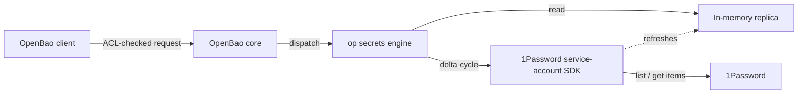

# openbao-plugin-secrets-onepassword

[](https://github.com/sweepies/openbao-plugin-secrets-onepassword/actions/workflows/ci.yml)
[](https://opensource.org/licenses/MPL-2.0)

`op` is an [OpenBao](https://openbao.org/) secrets engine that serves
[1Password](https://1password.com/) items live, through 1Password's
service-account Go SDK. It holds no durable copy of item data: values
are cached in an in-memory replica, refreshed on a delta cycle, and
refetched from 1Password whenever a plugin process restarts.

This is a fork of
[NavistAu/openbao-plugin-secrets-onepassword](https://github.com/NavistAu/openbao-plugin-secrets-onepassword)
at v0.1.0. It adds the `kv/` read, ships as an OCI plugin image, and
builds reproducible release binaries.

## Why this exists

1Password already secures the secret data. What it does not give you
is OpenBao's audit log, ACL model, and dynamic-secret ecosystem sitting
in front of that data. This engine puts a live 1Password vault behind
an OpenBao mount: every read is ACL-gated and audit-logged by OpenBao,
without OpenBao ever taking custody of the underlying secret. Nothing
written to `bao`'s storage backend needs to be trusted with 1Password
item contents, because nothing is written there — the replica lives in
process memory only and is rebuilt from 1Password on every cold start.

That second-order benefit is the point: teams that already manage
access through OpenBao policy get the same governance over
1Password-origin secrets, without copying the data out of 1Password
and without granting 1Password credentials directly to every
consumer.

## Terms

| Term | Meaning here |
| --- | --- |
| item | A 1Password item: a credential, note, or other record with fields, optional sections, and tags. |
| vault (1Password) | A 1Password container for items. Distinct from an OpenBao mount. |
| mount (OpenBao) | The OpenBao path where this engine is enabled (for example `op/`). Distinct from a 1Password vault. |
| replica | This engine's in-memory copy of one allowlisted vault's items. Rebuilt from 1Password on every cold start; never persisted to OpenBao storage. |
| field | A single named value inside an item, such as a password or username. |

## How it works



Every read (`item/…`, `field/…`, `kv/…`, `vaults/…`) is served from the
replica. If the replica's data for that vault is outside its freshness
window, the engine first runs a delta cycle: it lists changed items
since the last cycle and fetches only those, then serves the read from
the updated replica. A background timer also runs this delta cycle on
a fixed interval per vault, independent of reads, so the replica stays
warm even without traffic.

## When to use this

Use this engine when consumers already authenticate to OpenBao and you
want OpenBao ACLs and audit logging over secrets that live in
1Password, without copying those secrets into OpenBao's storage
backend or handing out 1Password credentials directly.

Do not use this engine as a general 1Password client, as a way to
migrate secrets permanently into OpenBao (it never stores item data
durably), or where sub-second freshness on every single read is
required regardless of request budget — the replica model trades some
staleness for a bounded, predictable 1Password API request rate.

## Requirements

- An OpenBao server. Built and tested against `openbao/sdk/v2` v2.6.2
  and `openbao/api/v2` v2.6.0. OCI installation needs OpenBao 2.6 or
  newer.
- A 1Password service-account token with read access to the vaults
  you allowlist.

## Installation

Each [release](https://github.com/sweepies/openbao-plugin-secrets-onepassword/releases)
publishes:

- the multi-arch OCI image `ghcr.io/sweepies/openbao-plugin-secrets-onepassword:<tag>`
  (linux/amd64, linux/arm64), with the binary at the image root and named
  by `ENTRYPOINT`;
- `linux_amd64` and `linux_arm64` archives, with `SHA256SUMS` for the
  archives and `SHA256SUMS.binaries` for the binaries inside them;
- `IMAGE`, the image reference pinned by manifest digest.

GitHub build-provenance attestations cover the image, the archives and
the binaries (`gh attestation verify`). Builds are reproducible:
`mise run release:build <tag>` on any machine produces the same binary
hashes.

### As an OCI plugin

On OpenBao 2.6, pin the binary hash from `SHA256SUMS.binaries`:

```hcl
plugin_directory     = "/openbao/plugins"   # must be writable
plugin_auto_download = true
plugin_auto_register = true

plugin "secret" "onepassword" {
  image       = "ghcr.io/sweepies/openbao-plugin-secrets-onepassword"
  version     = "v0.2.0"
  binary_name = "openbao-plugin-secrets-onepassword"
  sha256sum   = "<linux binary SHA-256>"
}
```

OpenBao 2.7 can instead pin the image by manifest digest (the `IMAGE`
asset) and reads the binary name from `ENTRYPOINT`:

```hcl
plugin "secret" "onepassword" {
  image = "ghcr.io/sweepies/openbao-plugin-secrets-onepassword:v0.2.0@sha256:<manifest digest>"
}
```

The plugin reports its release tag as its version, so `version` must
match the tag.

### From a release archive

Verify the archive against `SHA256SUMS`, extract
`openbao-plugin-secrets-onepassword` into the plugin directory, and
register it with the binary's hash:

```sh
bao plugin register -sha256="<linux binary SHA-256>" -version=v0.2.0 \
  -command=openbao-plugin-secrets-onepassword secret onepassword
```

### Mount and configure

```sh
bao secrets enable -path=op onepassword
```

Write the configuration with the service-account token piped through
stdin, never through an argument, so the token never appears in a
process listing:

```sh
printf '%s' "$OP_SERVICE_ACCOUNT_TOKEN" | bao write op/config \
  service_account_token=- vaults=Infra refresh_interval=15m
```

Leave `ratelimit_probe_cmd` unset unless you need it: it makes the
engine execute the configured binary inside the OpenBao server's
environment.

## Paths

| Path | Operation | Returns |
| --- | --- | --- |
| `vaults` | list | allowlisted vaults |
| `vaults/<vault>/items` | list | the vault's items |
| `item/<vault>/<item>` | read | the whole item: `fields` (a list of `{id, title, type, value, section_id}`), `sections`, `notes`, `tags`, metadata |
| `field/<vault>/<item>/[<section>/]<field>` | read | one field's `value`, `title`, `type` |
| `kv/<vault>/<item>` | read | the item's fields as `{label: value}` |
| `status`, `refresh[/<vault>]`, `invalidate[/<vault>]`, `config` | | see below |

`<vault>` and `<item>` are titles or IDs. `kv/` is the shape KV clients
read: `bao kv get -field=password op/kv/Infra/postgres`, or a fnox
`vault` provider with `path = "op/kv/Infra"` and `value = "postgres/password"`.
A label that occurs more than once in an item is keyed
`<section>.<label>`. Repeats outside any section, or within one
section, make the `kv/` read fail; use `field/` for those items.
`kv/` returns only field values, without staleness metadata.

## Configuration reference

All fields are written to `op/config`. `service_account_token` is
required on every write; every other field defaults if omitted. A
write always replaces the whole configuration.

| Field | Type | Default | Effect |
| --- | --- | --- | --- |
| `service_account_token` | string | none, required | Concealed on read. Rewriting it rotates the engine's 1Password client. |
| `vaults` | comma-separated strings | none | Allowlisted 1Password vault names or IDs this engine serves. |
| `refresh_interval` | duration | `15m` | Interval between delta cycles per vault. |
| `daily_request_limit` | integer | `1000` | Sets the daily budget the usage-ceiling calculation uses. |
| `hourly_read_limit` | integer | `1000` | Sets the hourly budget the usage-ceiling calculation uses. |
| `passthrough` | boolean | `true` | Serve reads within the freshness window without waiting for the periodic cycle. |
| `passthrough_ceiling_pct` | integer | `25` | Usage ceiling, as a percent of configured limits, above which passthrough fresh-fetches stop. |
| `passthrough_ttl` | duration | `1m` | Per-vault freshness window. `0` means every read triggers a delta cycle. |
| `serve_stale` | boolean | `true` | Serve stale replica data during a 1Password outage instead of failing the read. |
| `negative_cache_ttl` | duration | `30s` | How long the engine caches an unknown miss before retrying. |
| `path_split` | string | empty | Optional delimiter or regex that splits item titles into path segments. Empty means flat titles. |
| `always_fresh` | comma-separated strings | none | `vault/title` entries that bypass the freshness window on every read. |
| `ratelimit_probe_cmd` | string | empty | Optional absolute path to a pinned `op` binary for usage probing. |

A write is rejected if any of the following hold:

- `service_account_token` is empty.
- `refresh_interval` is not positive.
- `daily_request_limit` is not positive.
- `hourly_read_limit` is not positive.
- `passthrough_ceiling_pct` is outside 0–100.
- `passthrough_ttl` is negative.
- `negative_cache_ttl` is negative.
- `ratelimit_probe_cmd` is set but not an absolute path.
- `path_split` is set but does not compile as a regex.
- An `always_fresh` entry is not shaped `vault/title`.
- The steady-state list cost (vault count × 86400 ÷ refresh_interval
  seconds) exceeds 25% of `daily_request_limit` (`checkGuardrail` in
  `backend/config.go`).

## Errors and log messages

The engine itself keeps no logger; every failure surfaces as an API
error or as a field on `op/status`. The plugin's process wrapper
(`cmd/openbao-plugin-secrets-onepassword`) logs two startup/shutdown
conditions:

| Log message | When it appears |
| --- | --- |
| `failed to parse flags`. | The process received flags OpenBao's plugin launcher did not set. |
| `plugin shutting down`. | The plugin's gRPC server returned, ending the process. |

The engine's own failures surface as API-response error text, not as
log lines:

| Error message | Meaning |
| --- | --- |
| `op: not found`. | Nothing in the replica matches this vault, item, or field. |
| `op: ambiguous title`. | Two or more items share this title. Use the item ID or `path_split` instead. |
| `op: replica empty, cold start incomplete`. | The plugin restarted and has not finished its first delta cycle yet. |
| `op: replica data exceeds staleness bound and serve_stale is disabled`. | The replica is too old. `serve_stale` is off, so the read failed. |
| `op: 1password client unavailable, retrying`. | Config is loaded, but the 1Password client is not built yet. The engine is retrying. |
| `op: engine not configured`. | No configuration has been written to `op/config` yet. |
| `op: request gate denied cycle`. | The rate governor deferred this cycle to protect the usage ceiling. |
| `service_account_token is required`. | A config write omitted the required token field. |
| `config rejected: steady-state list cost … exceeds … of daily_request_limit …`. | Vault count × 86400 ÷ refresh_interval seconds exceeds 25% of `daily_request_limit` (`checkGuardrail`). Raise `daily_request_limit` or `refresh_interval` instead. |

## Troubleshooting

- Read `op/status`. It reports per-vault item counts, last refresh
  time, consecutive failure counts, rate-governor state, and probe
  health — with no secret material.
- If a read fails with `op: replica empty, cold start incomplete`,
  wait for the next delta cycle or check `op/status` for
  `client_init_failures` and `client_init_last_err`.
- If a read fails with `op: replica data exceeds staleness bound and
  serve_stale is disabled`, either set `serve_stale=true` or resolve
  the underlying 1Password connectivity or auth problem so the next
  cycle can succeed.
- If `op/status` shows a nonzero `governor.client_init_failures` or a
  `rate_limited`/`auth_failed` state, check `client_init_last_err`
  for the 1Password SDK's own error text.
- If configured `always_fresh` entries appear in
  `always_fresh_unmatched`, the pattern matched no item in any
  allowlisted vault; check the vault name and item title.

## Operations

- To force a refetch without waiting for the next cycle, write to
  `op/refresh` (all vaults) or `op/refresh/<vault>`.
- To clear cached state without spending a 1Password request, write to
  `op/invalidate` (all vaults) or `op/invalidate/<vault>`. See Design
  constraints below for what invalidation does and does not cost.

## Design constraints

- No durable copy of 1Password item data. The replica lives in process
  memory only; a plugin restart means a full cold refetch, never a
  read from OpenBao storage.
- Delta cycles, not full syncs. After the first cold fetch, each cycle
  lists changed items since the last cycle and fetches only those, to
  keep 1Password API usage bounded and predictable.
- A rate governor sits in front of every 1Password-spending operation.
  It tracks rolling usage against the configured hourly and daily
  limits, classifies 1Password errors as rate-limited, auth-failed, or
  other, and applies exponential backoff independently for delta
  cycles and client construction.
- Passthrough reads and the periodic background cycle share the same
  budget and the same governor; passthrough and periodic work is the
  first to be deferred when usage approaches the configured ceiling,
  while a miss-triggered lookup or a manual `op/refresh` is not.
- Zero-spend invalidation (`op/invalidate`) exists specifically to let
  an operator expire a freshness window without touching the
  1Password request budget; the actual refetch cost lands on whatever
  read or scheduled cycle touches that vault next.

## Development

Tools come from [mise](https://mise.jdx.dev). `mise run ci` runs
everything GitHub runs: `go mod tidy -diff`, formatting, `go vet`,
golangci-lint, the workflow lint, the race-enabled test suite, and a
build. The tests run against fakes for both the 1Password SDK and
OpenBao storage, so they need no 1Password account or OpenBao server.

Releases are cut by pushing a `vX.Y.Z` tag.

## License

MPL-2.0. See [LICENSE](LICENSE).
